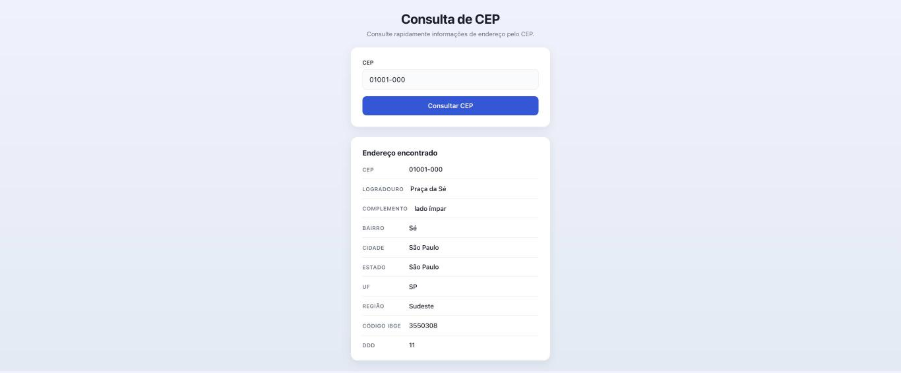
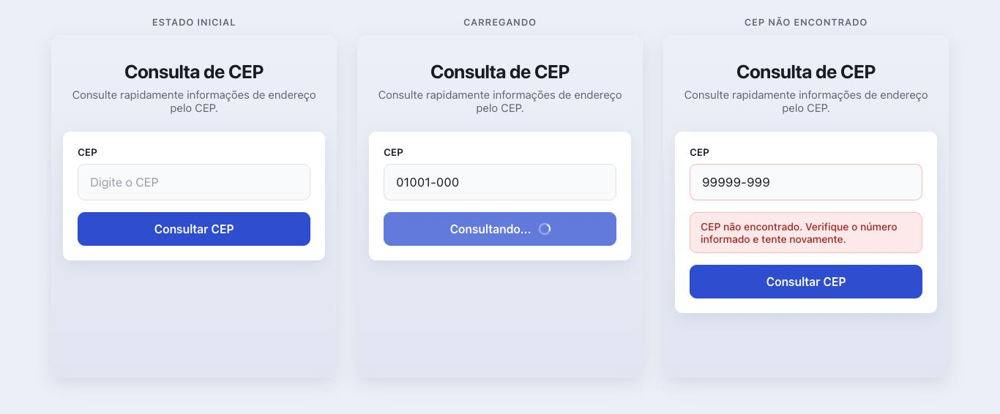
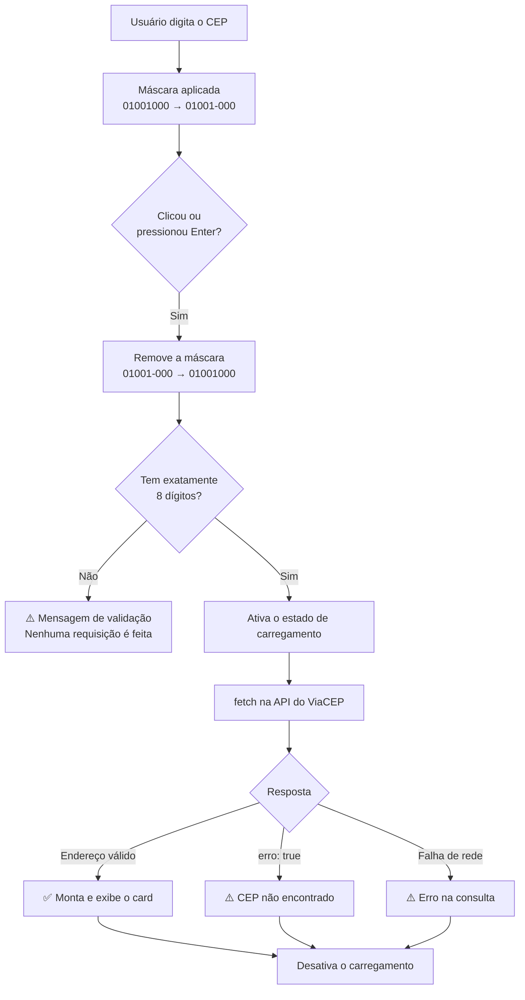

<h1 align="center">📍 Consulta de CEP</h1>

<p align="center">
  Aplicação web para consulta de endereços brasileiros pelo CEP,<br />
  construída com <strong>HTML, CSS e JavaScript puro</strong> — sem frameworks, sem bibliotecas, sem build.
</p>

<p align="center">
  
  
  
  
  
</p>

<p align="center">
  
</p>

---

## 📖 Sobre o projeto

Este é um projeto **didático**. Ele resolve um problema simples e real — descobrir um endereço a partir do CEP — e serve como material de estudo para quem está aprendendo desenvolvimento web.

O código é inteiramente **comentado em português**, explicando não apenas *o que* cada trecho faz, mas **por que** foi feito daquela forma. Cada arquivo é organizado em passos numerados, pensados para serem lidos de cima para baixo, como um tutorial.

> 💡 **Para estudantes:** comece pelo `index.html`, depois vá para o `css/style.css` e termine no `js/script.js`. Os comentários foram escritos nessa ordem de leitura.

### Por que sem frameworks?

Porque entender a base torna qualquer framework mais fácil depois. Aqui você vê, sem camadas de abstração no meio:

- como o navegador realmente dispara eventos;
- como uma requisição HTTP é feita e tratada;
- como elementos HTML são criados por código;
- como o CSS organiza um layout responsivo.

---

## 🖼️ Estados da interface

Uma boa interface comunica o que está acontecendo. Esta trata cinco estados distintos:

<p align="center">
  
</p>

| Estado | O que acontece |
|---|---|
| **Inicial** | Apenas o formulário de busca é exibido |
| **Validação** | CEP com formato inválido: mensagem imediata, **sem requisição à API** |
| **Carregando** | Botão desabilitado, texto alterado e spinner em CSS puro |
| **Sucesso** | Card com os dados do endereço, com animação suave de entrada |
| **Erro** | Mensagens distintas para "CEP não encontrado" e "falha na comunicação" |

---

## ✨ Funcionalidades

- 🎭 **Máscara automática** — digite `01001000` e o campo formata para `01001-000` sozinho
- ✅ **Validação local** — exige exatamente 8 dígitos antes de gastar uma requisição
- ⌨️ **Busca com Enter** — além do clique no botão
- 🔄 **Consultas sucessivas** — o resultado novo substitui o anterior
- 🚫 **Proteção contra cliques duplicados** — uma consulta por vez
- 📱 **Totalmente responsivo** — de 320px até desktop, sem scroll horizontal
- ♿ **Acessível** — HTML semântico, `label` associado, foco visível e `aria-live`
- 📦 **PWA instalável** — funciona offline e pode ser adicionado à tela inicial

---

## 🛠️ Tecnologias

| Tecnologia | Uso no projeto |
|---|---|
| **HTML5** | Estrutura semântica (`main`, `header`, `form`, `section`, `dl`) |
| **CSS3** | Variáveis, Flexbox, Grid, media queries, transições e animações |
| **JavaScript (ES6+)** | `const`/`let`, `async/await`, `fetch`, template literals, destructuring |
| **Service Worker** | Cache do app shell para funcionamento offline |
| **ViaCEP** | API pública e gratuita de consulta de CEPs |

**Dependências externas: nenhuma.** Não há `package.json`, `node_modules` nem etapa de build.

---

## 📂 Estrutura de arquivos

```
consulta-cep/
├── index.html          # Estrutura da página
├── manifest.json       # Configuração do PWA (nome, ícones, cores)
├── sw.js               # Service worker: cache e suporte offline
├── css/
│   └── style.css       # Toda a aparência da aplicação
├── js/
│   └── script.js       # Toda a lógica da aplicação
├── icons/              # Ícones do PWA em vários tamanhos
└── docs/               # Imagens usadas neste README
```

Cada arquivo tem **uma responsabilidade só** — essa separação é um dos princípios mais importantes do desenvolvimento web.

---

## 🚀 Como executar

### Opção 1 — Servidor local (recomendado)

O service worker exige `http://` ou `https://` para funcionar. Escolha um comando:

```bash
# Python (já vem instalado no macOS e na maioria das distribuições Linux)
python3 -m http.server 8000

# Node.js
npx serve .

# PHP
php -S localhost:8000
```

Depois acesse **http://localhost:8000** no navegador.

### Opção 2 — Abrir o arquivo diretamente

Basta dar um duplo clique no `index.html`. A consulta de CEP funciona normalmente — apenas o recurso offline do PWA fica indisponível, porque o protocolo `file://` não permite service workers.

> 💡 Usando **VS Code**? A extensão *Live Server* resolve tudo com um clique.

---

## ⚙️ Como funciona

O fluxo completo, do clique até a tela:



### A API do ViaCEP

```
GET https://viacep.com.br/ws/{cep}/json/
```

Exemplo real — `https://viacep.com.br/ws/01001000/json/`:

```json
{
  "cep": "01001-000",
  "logradouro": "Praça da Sé",
  "complemento": "lado ímpar",
  "bairro": "Sé",
  "localidade": "São Paulo",
  "uf": "SP",
  "estado": "São Paulo",
  "regiao": "Sudeste",
  "ibge": "3550308",
  "ddd": "11"
}
```

> ⚠️ **Pegadinha importante:** quando o CEP tem formato válido mas **não existe**, o ViaCEP responde com status HTTP **200 (sucesso)** e o corpo `{ "erro": "true" }`. Do ponto de vista da rede deu tudo certo — quem precisa detectar o problema é a aplicação. O código trata exatamente esse caso.

---

## 🎓 Roteiro de estudo

Os arquivos são divididos em passos numerados. Use esta tabela como índice:

### `js/script.js`

| Passo | Conteúdo | Conceitos que você aprende |
|---|---|---|
| 1 | Constantes de configuração | Evitar *magic strings*, configuração orientada a dados |
| 2 | Captura dos elementos | `getElementById`, por que o script fica no fim do `<body>` |
| 3 | Estado da aplicação | `const` vs `let`, controle de estado |
| 4 | Máscara do CEP | Expressões regulares, `slice`, template literals |
| 5 | Validação | Âncoras `^` e `$` em regex, `.test()` |
| 6 | Consulta à API | `async/await`, `fetch`, por que checar `response.ok` |
| 7 | Atualização da interface | `createElement`, `textContent` vs `innerHTML` (XSS) |
| 8 | Fluxo principal | `preventDefault`, `try/catch/finally`, *early return* |
| 9 | Registro dos eventos | `addEventListener`, `submit` vs `click` |
| 10 | Service worker | *Feature detection*, melhoria progressiva |

### `css/style.css`

| Seção | Conceitos que você aprende |
|---|---|
| 1 | Variáveis CSS (*custom properties*) e por que centralizar o tema |
| 2 | `box-sizing: border-box` explicado com exemplo numérico |
| 3 | Flexbox: eixo principal, eixo cruzado e `gap` |
| 6 | Estados de formulário e por que **nunca** remover o indicador de foco |
| 8 | Como construir um spinner do zero, só com CSS |
| 9 | CSS Grid: `minmax()`, a unidade `fr` e listas de descrição |
| 10 | Media queries e estratégia de adaptação para telas pequenas |

---

## ✅ Testes realizados

Todos executados no navegador, contra a API real do ViaCEP:

| # | Cenário | Entrada | Resultado |
|---|---|---|---|
| 1 | CEP válido com máscara | `01001-000` | ✅ Exibe os 10 campos do endereço |
| 2 | CEP válido sem máscara | `01001000` | ✅ Máscara aplicada e consulta realizada |
| 3 | CEP inválido | `123` | ✅ Mensagem de validação, sem requisição |
| 4 | CEP inexistente | `99999999` | ✅ "CEP não encontrado" |
| 5 | Nova consulta | duas buscas seguidas | ✅ Resultado anterior substituído |
| 6 | Tecla Enter | `01001-000` + `Enter` | ✅ Consulta realizada |
| 7 | Responsividade | 320 a 1024px | ✅ Zero overflow horizontal |

**Verificações adicionais:** console sem erros, service worker ativo com os 8 arquivos do app shell em cache, e a grade de resultados alternando corretamente entre 1 coluna (≤480px) e 2 colunas (≥768px).

---

## 🧠 Decisões técnicas

<details>
<summary><strong>Por que o campo é <code>type="text"</code> e não <code>type="number"</code>?</strong></summary>

<br />

Porque a máscara insere um hífen (`01001-000`), e um campo numérico não aceita esse caractere. Para manter a boa experiência no celular, usamos `inputmode="numeric"`, que abre o teclado numérico sem restringir o conteúdo.

</details>

<details>
<summary><strong>Por que escutar <code>submit</code> no formulário em vez de <code>click</code> no botão?</strong></summary>

<br />

Porque o evento `submit` é disparado tanto pelo clique quanto pela tecla **Enter**. Escutando um único evento, atendemos aos dois casos de uso sem código extra.

</details>

<details>
<summary><strong>Por que as consultas à API não entram no cache do service worker?</strong></summary>

<br />

Porque cachear dados dinâmicos traria um problema sério: se o endereço mudasse — ou se a primeira resposta tivesse sido um erro — o usuário continuaria recebendo o dado velho indefinidamente.

A regra geral vale para qualquer projeto:
- **Arquivos estáticos** (HTML, CSS, JS, imagens) → cache é ótimo
- **Dados dinâmicos de API** → busque sempre na rede

</details>

<details>
<summary><strong>Por que usar <code>textContent</code> em vez de <code>innerHTML</code>?</strong></summary>

<br />

`innerHTML` interpreta o conteúdo como HTML. Se o texto vier de fora — do usuário ou de uma API —, alguém poderia injetar código malicioso na página. Esse tipo de ataque se chama **XSS** (*Cross-Site Scripting*).

`textContent` insere o valor como texto puro, sem interpretar nada. Regra prática: se você quer mostrar texto, use `textContent`.

</details>

<details>
<summary><strong>Por que a lista de campos fica no JavaScript e não no HTML?</strong></summary>

<br />

A constante `CAMPOS_DO_ENDERECO` faz a ponte entre o nome técnico da API (`localidade`) e o rótulo amigável (`Cidade`). Mantendo-a no JS:

1. a ordem da lista define a ordem na tela — basta reordenar;
2. adicionar um campo novo é acrescentar uma linha;
3. a função que desenha o resultado fica curta e genérica.

Esse padrão se chama **configuração orientada a dados**.

</details>

---

## 🔧 Exercícios propostos

Quer praticar? Sugestões de evolução, em ordem crescente de dificuldade:

1. **Fácil** — adicione um botão "Limpar" que zera o campo e esconde o resultado
2. **Fácil** — exiba a quantidade de caracteres restantes enquanto o usuário digita
3. **Médio** — adicione um botão para copiar o endereço completo para a área de transferência
4. **Médio** — guarde as últimas 5 consultas no `localStorage` e mostre um histórico
5. **Médio** — implemente um tema escuro usando as variáveis CSS já existentes
6. **Difícil** — adicione a busca reversa do ViaCEP (encontrar o CEP a partir de UF, cidade e rua)
7. **Difícil** — exiba o endereço em um mapa

> Ao alterar HTML, CSS ou JS, lembre-se de atualizar a versão do cache em `sw.js` (`consulta-cep-v1` → `consulta-cep-v2`), senão o navegador continuará servindo os arquivos antigos.

---

## 🙏 Créditos

- **[ViaCEP](https://viacep.com.br)** — API pública e gratuita de consulta de CEPs

---

<p align="center">
  Feito com 💙 para quem está aprendendo desenvolvimento web.
</p>
